<p align="center">
  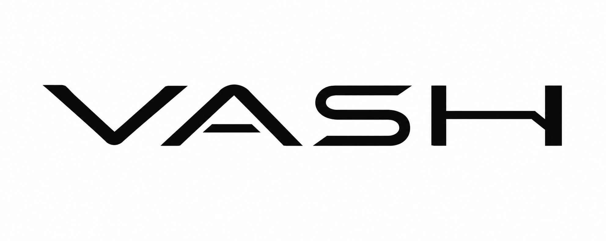
</p>

<p align="center">
  <strong>VASH</strong> &nbsp; <em>Vision-Anchored Self-Healing Prosthetic Hand</em><br>
  근전도와 비전 AI를 결합한 사용자 중심 로봇 의수
</p>

<p align="center">
  
  
  
  
</p>

<p align="center">
  <a href="#overview">Overview</a> ·
  <a href="#배경과-목표">프로젝트 소개</a> ·
  <a href="#시스템-구성">시스템 구성</a> ·
  <a href="#제작-및-시연">제작 및 시연</a> ·
  <a href="#평가-결과">평가 결과</a> ·
  <a href="#향후-과제">향후 과제</a>
</p>

---

## Overview

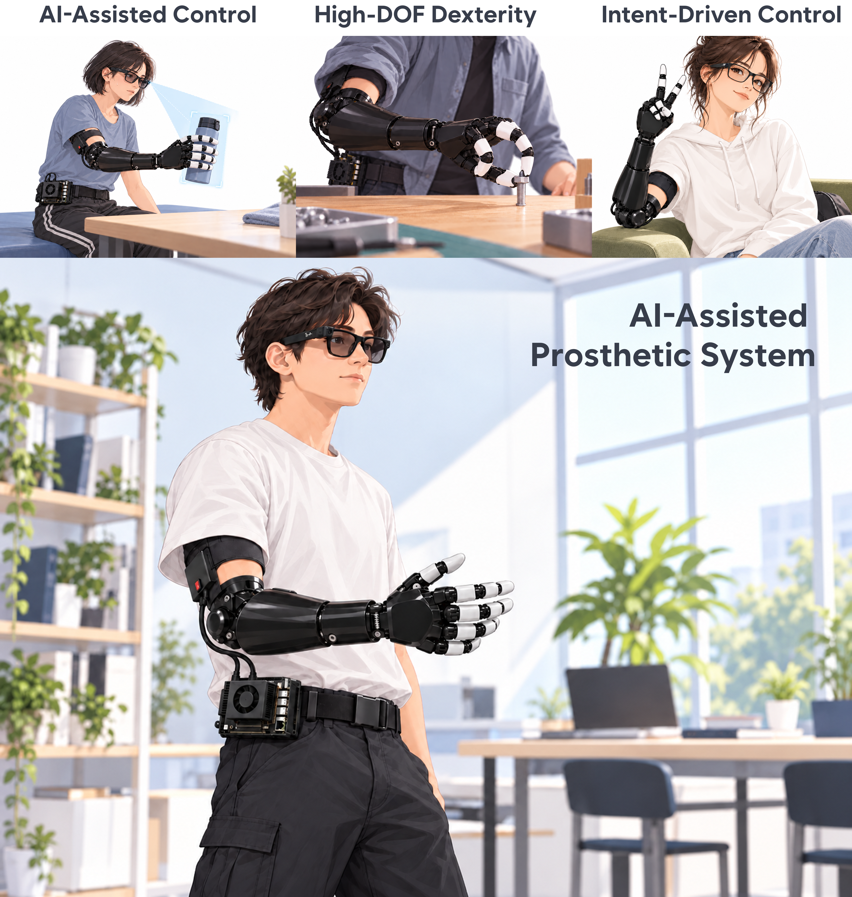

다채널 근전도(EMG)와 영상 기반 인공지능을 결합해 사용자의 손동작 의도와 주변 물체를 함께 고려하는 로봇 의수 연구 프로젝트입니다. 근육 피로와 신호 특성 변화에 대응하는 자가치유 제어와 객체 인식 기반 파지 보조를 통해, 일상 환경에 적응하는 사용자 중심의 의수 제어를 목표로 합니다.

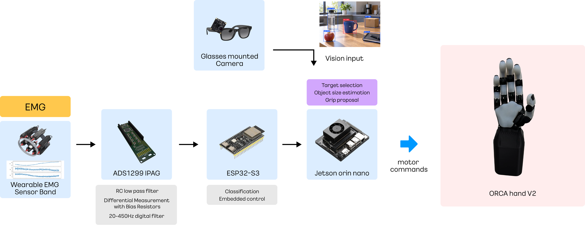

> **프로젝트 상태:** 연구 및 개발 단계입니다. Jetson 비전 모듈의 소스와 설치·실행 절차를 [src/vision/](src/vision/)에 공개했습니다. EMG·의수 제어를 포함한 전체 통합 시스템과 하드웨어 자료는 정리 중입니다. 아래 평가는 각 연구 조건에 한정됩니다.

## 배경과 목표

근전도 기반 의수는 근육에서 발생하는 전기 신호를 이용해 사용자의 동작 의도를 추정합니다. 하지만 근육 피로, 전극 위치, 팔 자세가 바뀌면 신호 특성도 달라져 동작 분류와 제어가 불안정해질 수 있습니다. 또한 EMG만으로는 사용자가 잡으려는 물체의 형태와 크기를 알기 어렵습니다.

VASH는 이 두 문제를 함께 다룹니다.

- **사용자 의도 인식:** 다채널 EMG로 손동작을 분류합니다.
- **신호 변화 대응:** 자가치유(Self-Healing) 제어를 통해 피로와 신호 특성 변화에 따른 성능 저하를 보완하고자 합니다.
- **환경 인식과 파지 보조:** 카메라 영상에서 파지 대상을 찾고 물체에 적합한 그립과 손가락 개구량을 결정하도록 설계합니다.

## 시스템 구성

| 구성 요소 | 역할 |
| --- | --- |
| 16채널 EMG 센서 | 팔의 다채널 근전도 신호 측정 |
| ADS1299 신호 획득 모듈 | EMG 신호 획득 |
| ESP32-S3 | 센서 데이터 처리 및 시스템 제어 |
| 전방 카메라 | 사용자의 시야에 있는 물체 영상 획득 |
| Jetson Orin Nano | EMG·영상 기반 인식과 제어 처리 |
| ORCA Hand | 16자유도 로봇 손을 이용한 파지 동작 |

시스템은 EMG를 통해 **사용자가 어떤 동작을 원하는지** 추정하고, 영상에서 **어떤 물체를 잡으려는지**에 관한 정보를 얻습니다. 두 정보를 바탕으로 로봇 손의 동작을 보조하는 것이 목표입니다.

### EMG 기반 의도 인식과 자가치유

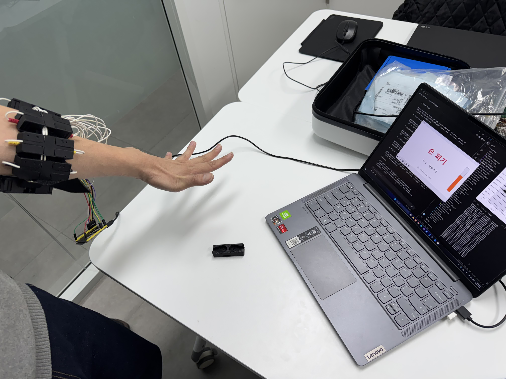

*직접 제작한 센서 밴드를 착용하고 손동작에 따른 근전도 데이터를 수집하는 모습.*

EMG 센서에서 얻은 신호로 휴식, 주먹, 세손가락, 집기와 같은 손동작을 구분합니다. 장시간 사용 중 근육 피로가 쌓이거나 측정 조건이 달라지면 같은 동작의 신호도 변할 수 있습니다. VASH의 자가치유 제어는 이러한 신호 변화에 적응해 동작 인식 성능의 저하를 보완하는 것을 목표로 합니다.

| 휴식 | 주먹 |
| --- | --- |
| 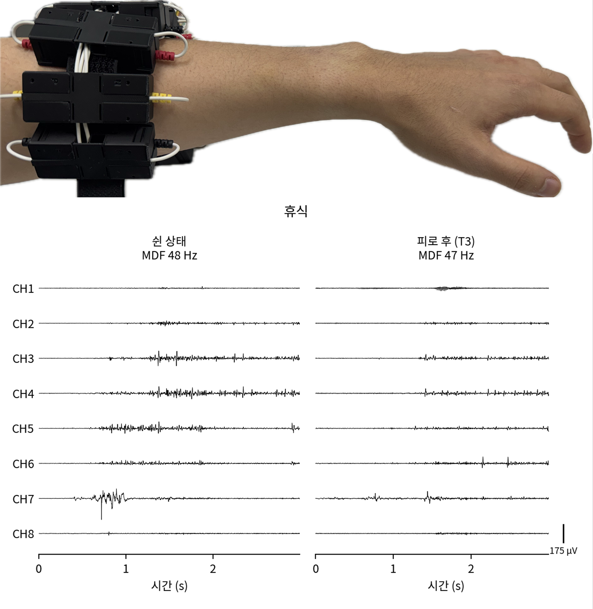 | 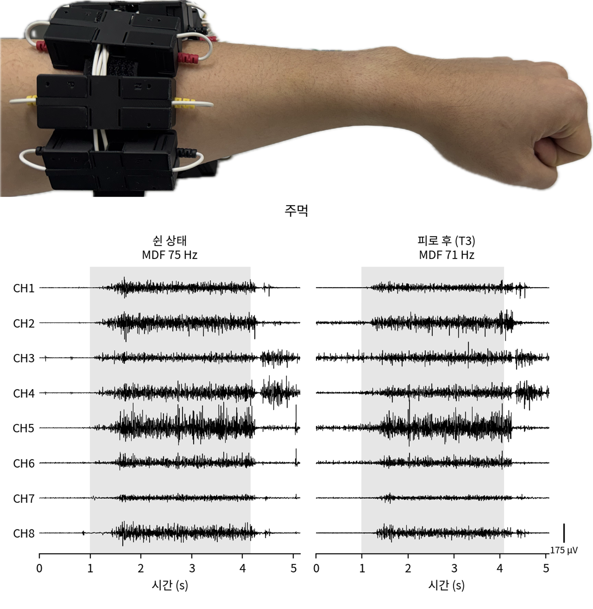 |
| 세손가락 | 집기 |
| 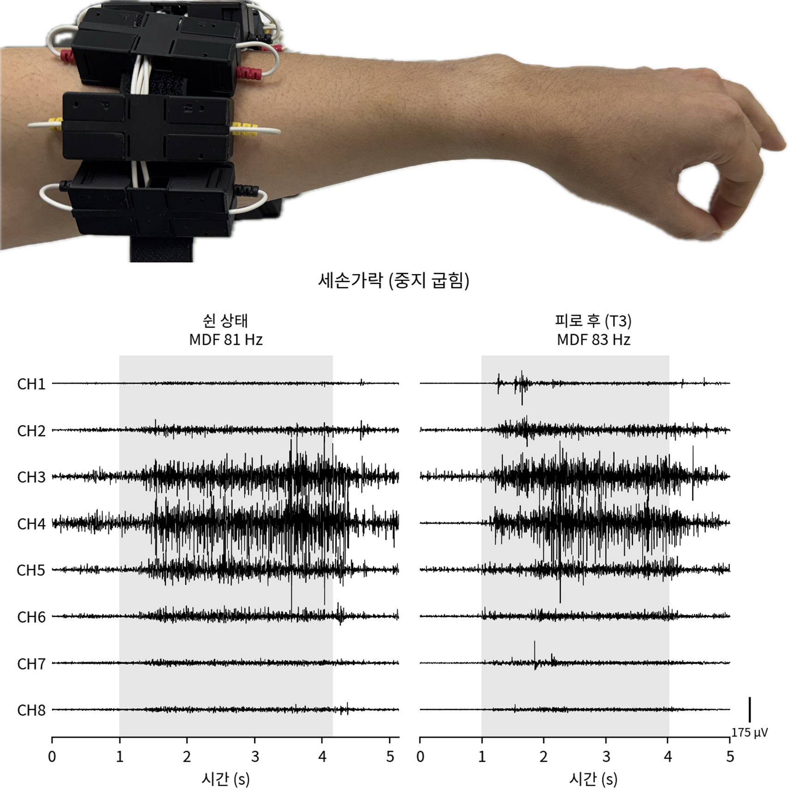 | 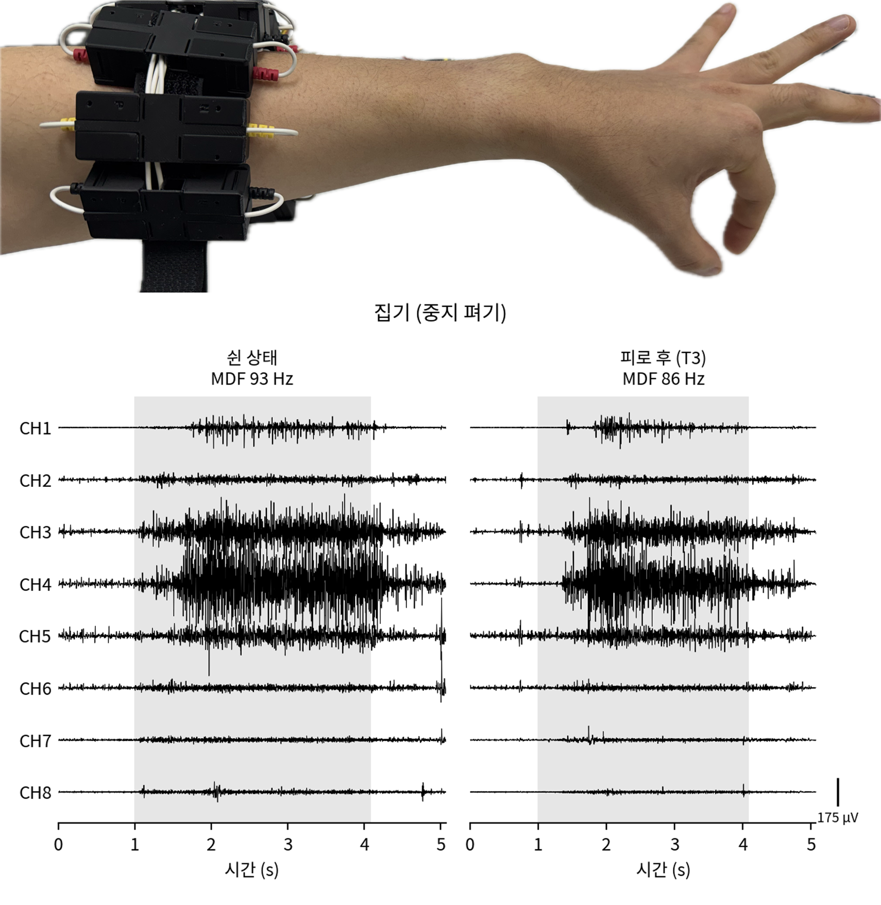 |

*동작별 다채널 EMG 신호 예시. 그림에는 각 동작에 대한 측정 신호가 표시되어 있습니다.*

### Vision AI 기반 파지 보조

전방 카메라 영상에서 객체를 인식하고, 화면 중심과의 거리를 고려하는 **Center Bias** 방식으로 파지 대상을 선정합니다. 선택한 물체의 크기와 형태에 관한 정보를 이용해 적합한 그립과 목표 손가락 개구량을 산출하도록 설계했습니다.

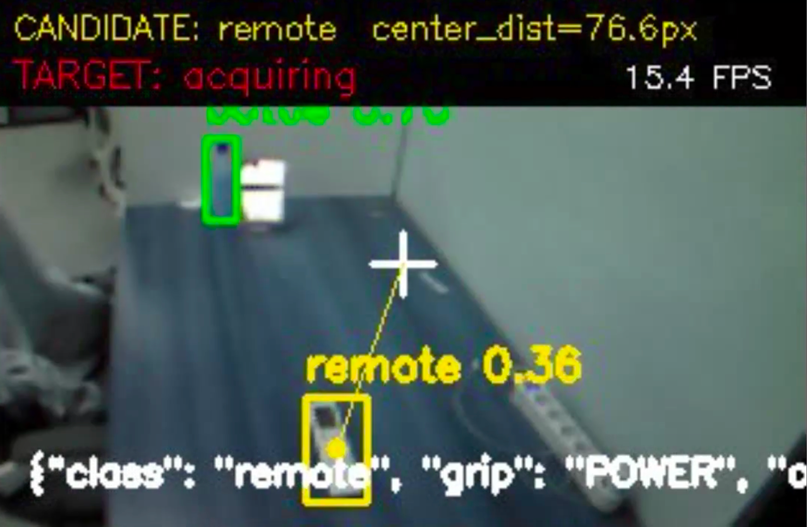

*객체 인식 및 대상 선정 화면 예시.*

### 공개된 Jetson 비전 코드

현재 기본 모델은 추가학습하지 않은 공식 **YOLO26m**이며 Jetson에서 생성한 TensorRT FP16 엔진을 사용합니다. ELP IMX291 영상에서 배경 37종을 제외한 물체 43종을 표시하고, 그립을 지원하는 8종에서 중앙 타깃을 선택합니다. 캔·펜 보조 모델은 기본 실행에서 제외했습니다.

- [비전 모듈 설명과 테스트](src/vision/README.md)
- [Jetson 설치·엔진 생성·실행](src/vision/deployment/JETSON_RUNBOOK.md)
- [Jetson → ESP32 UART 규격](src/vision/docs/UART_PROTOCOL.md)

브라우저 뷰어는 그립 제안을 표시하며 UART 송신은 별도 CLI 실행 기능입니다. 가중치·엔진·데이터는 Git에 포함하지 않으며, 모델 복원 스크립트를 제공합니다. 실제 카메라 정확도와 개구량 실측 보정은 추가 검증이 필요합니다.

### 로봇 손과 파지 시뮬레이션

16자유도 ORCA Hand를 사용해 다양한 손가락 동작과 파지를 구현합니다. 시뮬레이션에서는 캔, 펜, 스마트폰, 동전 등 형태가 다른 물체를 대상으로 접근부터 잡기, 들기, 유지까지의 과정을 살펴보았습니다.

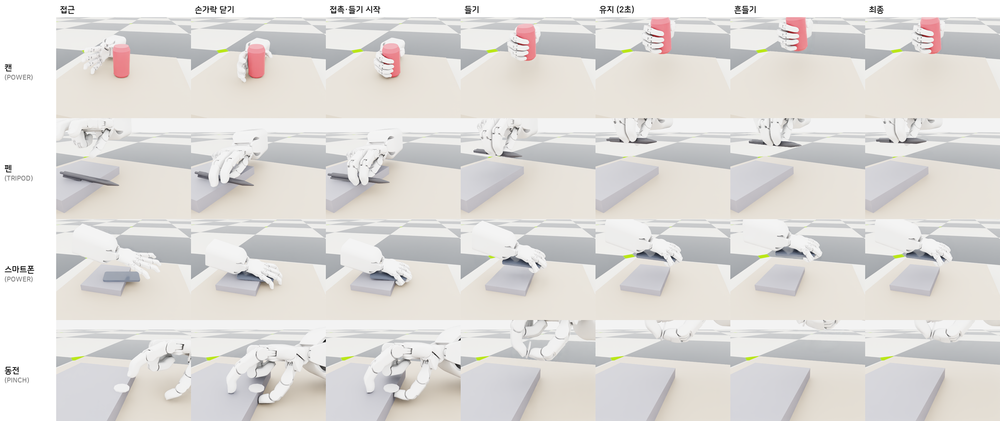

*물체와 그립 유형에 따른 파지 동작 시퀀스.*

## 제작 및 시연

아래 움직이는 이미지는 제작과 테스트 영상에서 각각 약 6초를 발췌한 것입니다.

| EMG 센서 밴드 착용 시연 | ORCA Hand 구동 테스트 |
| --- | --- |
| 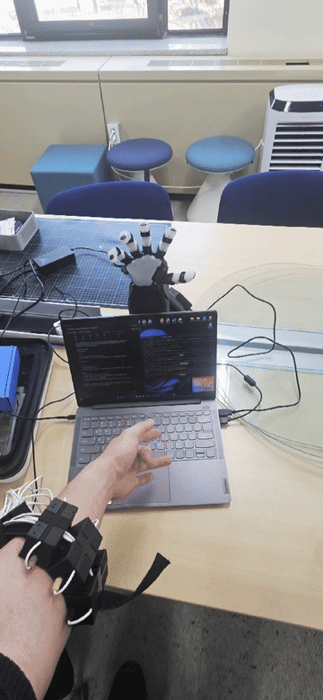 | 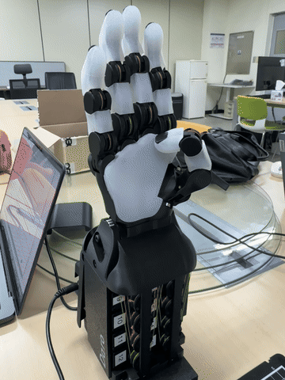 |

| 로봇 손 조립 | 손 부품 3D 프린팅 |
| --- | --- |
| 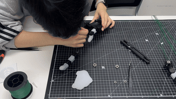 | 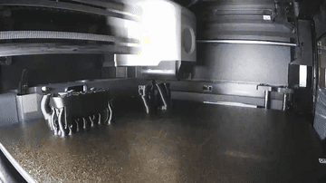 |

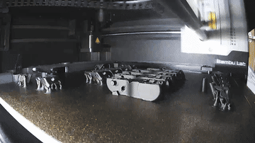

*로봇 손 조립과 부품 제작 과정.*

## 평가 결과

연구에서는 근육 피로에 따른 동작 분류와 EMG·비전 융합에 따른 파지 선택을 평가했습니다. 아래 그림은 해당 실험 및 분석의 결과를 보여줍니다.

### 피로 상태별 동작 분류

휴식 상태와 피로 측정 시점에 따른 네 가지 동작의 분류 정확도를 비교했습니다. 동작과 측정 시점에 따라 정확도가 달라지는 양상을 확인할 수 있습니다.

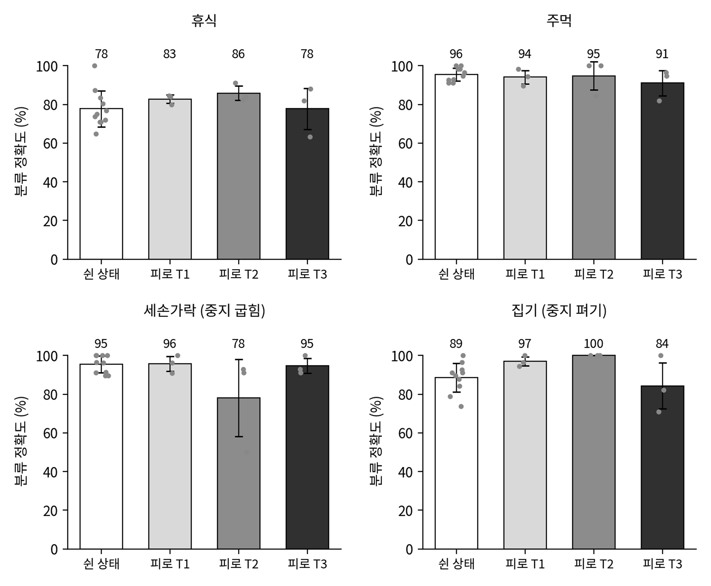

### EMG·비전 융합 평가

실측 EMG 기반 오프라인 평가에서 EMG만 사용한 경우와 EMG·비전을 융합한 경우의 파지 선택 오류를 비교했습니다. 그림은 평가한 조건에서 융합 방식의 오류가 더 낮은 결과와, 비전 인식률에 따른 오류 변화를 보여줍니다.

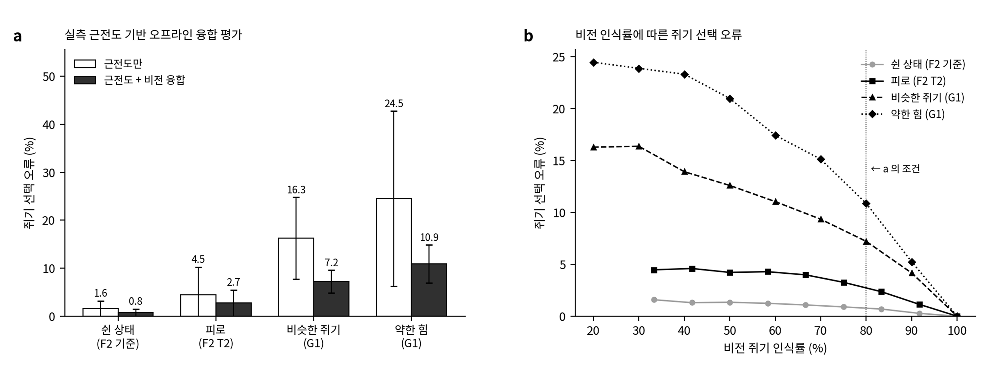

이 결과는 해당 평가 조건에 한정됩니다. 참가자 수, 데이터 수집 및 분할 방법, 자가치유 모델의 구체적인 동작과 실사용 환경에서의 성능은 추가 문서와 검증이 필요합니다. 시뮬레이션 결과를 실제 사용자 대상 성능으로 해석해서는 안 됩니다.

## 저장소 구조

```text
VASH/
├── README.md
├── fig/                  # 시스템, EMG 신호 및 평가 결과 이미지
├── docs/                 # 프로젝트 문서용 폴더
├── hardware/             # 하드웨어 자료용 폴더
└── src/
    ├── emg_hand_control/ # EMG 기반 손 제어 코드용 폴더
    └── vision/           # Jetson YOLO26m 검출·타깃 안정화·그립 제안 모듈
```

비전 모듈은 `cd src/vision` 후 해당 [README](src/vision/README.md)를 따릅니다. EMG 제어 및 하드웨어 자료는 정리 중입니다.

## 향후 과제

- 자가치유 제어와 EMG·비전 융합 방식의 구현 및 평가 절차 문서화
- 실제 사용 환경에서의 동작 인식, 파지 성능 및 장시간 안정성 검증
- 전극 위치와 팔 자세 변화 등 다양한 사용 조건에서의 평가
- 하드웨어 경량화와 착용성 개선
- 상지 절단자를 위한 의수 및 재활 보조 기술로의 확장 가능성 검토
