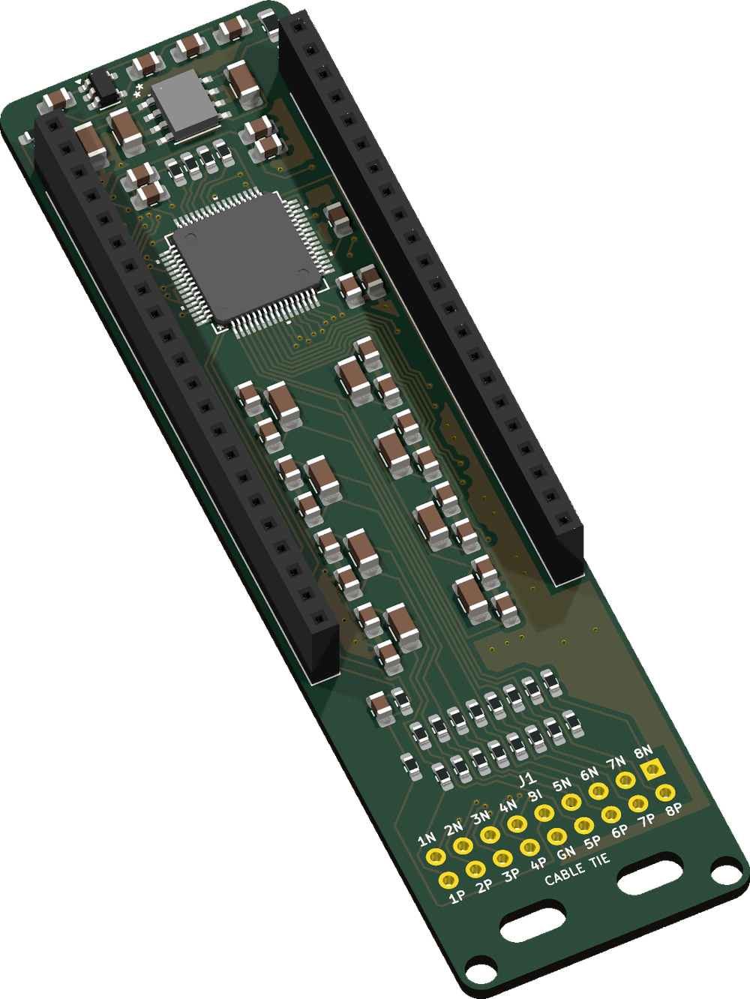
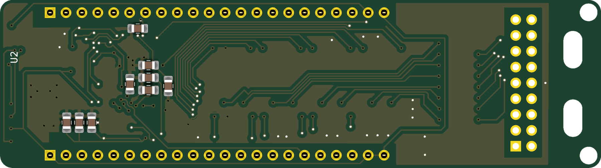
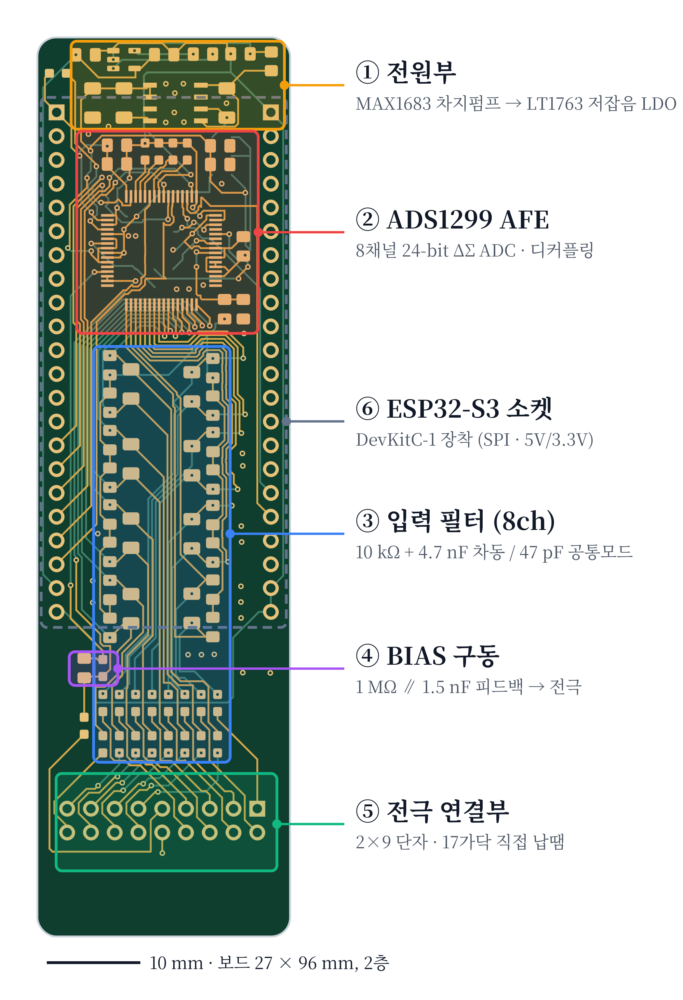
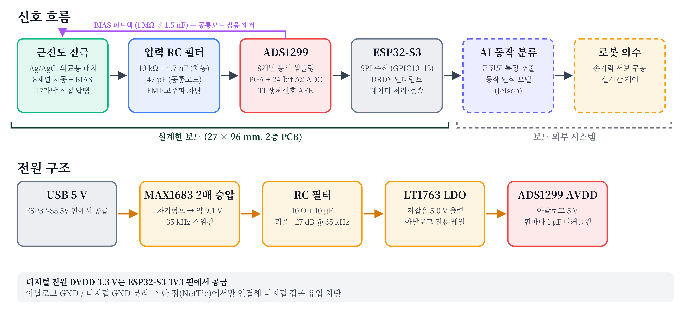
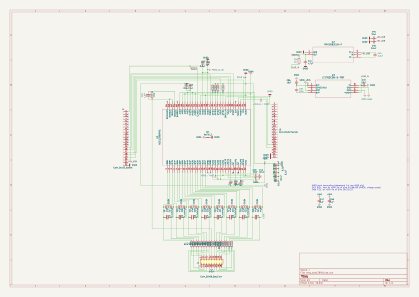
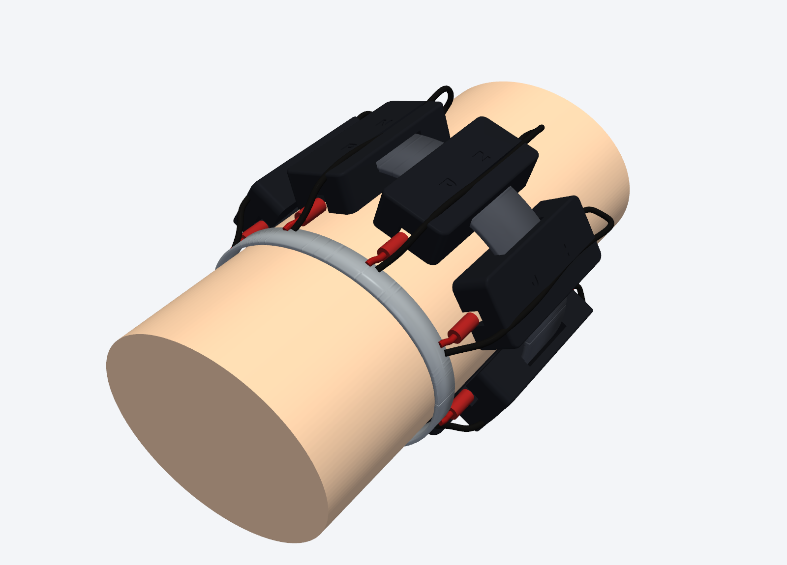

# 하드웨어

근전도(EMG)를 측정해 PC로 보내는 하드웨어입니다. 8채널 전극 밴드 → ADS1299 보드 → ESP32-S3 → PC 순서로 신호가 전달됩니다.

| 폴더 | 내용 |
|---|---|
| [`ads1299_board/`](ads1299_board/) | ADS1299 8채널 EMG 보드 (KiCad, 대회용 수정본) |
| [`ads1299_firmware/`](ads1299_firmware/) | ESP32-S3 펌웨어 (Arduino-ESP32 3.x): 보드 검진 + 실시간 스트리밍 |
| [`emg_electrode_band/`](emg_electrode_band/) | 전극 블록·뚜껑 CAD (STEP/STL), 렌더링·전극 배치 그림 스크립트 |

---

## ADS1299 보드

ESP32-S3-DevKitC-1 위에 소켓(J4, J5)으로 얹는 2층 보드입니다.

<p align="center">
  
</p>

**윗면**


**아랫면**



*KiCad 10 `kicad-cli`로 PCB 파일에서 만든 렌더링입니다. 실물 사진이 아닙니다.*

### 사양

| 항목 | 값 |
|---|---|
| 크기 | 27 × 96 mm, 2층 |
| 표면 처리 | ENIG |
| AFE | TI ADS1299IPAG (TQFP-64), 8채널 동시 샘플링, 24-bit ΔΣ ADC |
| 현재 스트리밍 설정 | 2000 SPS, 게인 24 (측정 범위 ±187.5 mV), 차동 입력 + BIAS |
| 입력 필터 (채널마다) | 10 kΩ + 4.7 nF (차동), 47 pF (공통모드) |
| 아날로그 전원 | USB 5 V → MAX1683 2배 승압 → RC 필터 → LT1763 LDO → 5.0 V |
| 디지털 전원 | ESP32-S3 3V3 핀 |
| PC 연결 | ESP32-S3 UART USB 포트, 921600 baud |

### 구성



| 구역 | 역할 |
|---|---|
| ① 전원부 | MAX1683 차지펌프와 LT1763 LDO로 아날로그 5 V 생성 |
| ② ADS1299 | 8채널 증폭·AD 변환, 전원 핀 디커플링 |
| ③ 입력 필터 | 채널별 RC 필터로 고주파 잡음 차단 |
| ④ BIAS 구동 | 1 MΩ ∥ 1.5 nF 피드백으로 공통모드 잡음 감소 |
| ⑤ 전극 연결부 (J1) | 2×9 단자에 전극선 17가닥을 직접 납땜 |
| ⑥ ESP32-S3 소켓 (J4, J5) | DevKitC-1 장착, SPI와 전원 연결 |

### 신호·전원 흐름



아날로그 GND와 디지털 GND는 분리하고 NetTie 한 점에서만 연결합니다.

### J1 전극 배선

보드 윗면에서 본 배치입니다. 한 열이 한 채널이며, 실크 인쇄와 같습니다.

| 위 줄 | 1N | 2N | 3N | 4N | **BI** | 5N | 6N | 7N | 8N |
|---|---|---|---|---|---|---|---|---|---|
| **아래 줄** | 1P | 2P | 3P | 4P | **GN** | 5P | 6P | 7P | 8P |

- `1N`/`1P`~`8N`/`8P`: 채널별 차동 입력
- `BI`: 바이어스 전극 (BIASIN)
- `GN`: GNDA. 전극용이 아니라 오실로스코프 프로브 접지용입니다

**납땜 순서:** 라벨 붙이기 → 납땜 → 쌍별로 꼬기 → 슬롯 2개에 케이블 타이 고정 → IPA로 플럭스 세척. ADS1299 입력 임피던스가 높아 세척이 중요합니다. 자세한 내용은 [`CHANGELOG_competition.md`](ads1299_board/docs/CHANGELOG_competition.md)에 있습니다.

### ESP32-S3 연결

펌웨어 기본 설정(`WIRING_MODE 0`) 기준입니다.

| 보드 | 신호 | 방향 | ESP32-S3 |
|---|---|---|---|
| J4.1 | DVDD | ← | 3V3 |
| J4.15 | DRDY | → | GPIO9 |
| J4.16 | CS | ← | GPIO10 |
| J4.17 | DIN | ← | GPIO11 (MOSI) |
| J4.18 | SCLK | ← | GPIO12 |
| J4.19 | DOUT | → | GPIO13 (MISO) |
| J4.20 | START | ← | GPIO14 |
| J4.21 | 5V | ← | 5V |
| J5.17 | RESET | ← | GPIO47 |
| J5.18 | PWDN | ← | GPIO21 |
| J4.22, J5.1, J5.21, J5.22 | GND | | GND |

> **주의:** GPIO47은 모듈에 따라 1.8 V입니다(이름에 `V`가 붙은 WROOM-2). 이 경우 RESET이 풀리지 않으니 모듈 이름을 먼저 확인하세요. [`design_review_2026-09-26.md`](ads1299_board/docs/design_review_2026-09-26.md)

### 확인 결과

| 항목 | 결과 | 방법 |
|---|---|---|
| KiCad DRC | 위반 0, 미연결 0 | `kicad-cli pcb drc`, 오류 등급, 2026-11-04 |
| AVDD / DVDD | 5.008 V / 3.093 V | 펌웨어 자가 검진, 실물 보드, 2026-11-02 |
| 입력 단락 잡음 (2000 SPS, 게인 24) | 채널 최대 0.394 µVrms | 펌웨어 자가 검진, 실물 보드, 2026-11-02 |
| 내부 테스트 신호 | 8채널 3.70 mVpp, 2.00 Hz (기대 3.75 mVpp) | 펌웨어 자가 검진, 실물 보드, 2026-11-02 |

### 파일

| 경로 | 내용 |
|---|---|
| `emg_ads1299.kicad_pro`, `.kicad_sch`, `.kicad_pcb` | KiCad 프로젝트, 회로도, PCB |
| `*.kicad_sym`, `*.pretty`, `MY_3D/` | 프로젝트 심볼, 풋프린트, 3D 모델 |
| `fabrication/` | Gerber·드릴, JLCPCB BOM/CPL, 수납땜 BOM |
| `docs/` | 수정 내역, 설계 검토, 파일 구조, 구성·흐름 그림 |
| [`docs/images/schematic.svg`](ads1299_board/docs/images/schematic.svg) | 회로도 전체 |

주요 부품은 [`BOM_handsolder.csv`](ads1299_board/fabrication/BOM_handsolder.csv)에 DigiKey 부품 번호와 함께 있습니다.

<details>
<summary>회로도 보기</summary>

[](ads1299_board/docs/images/schematic.svg)

</details>

**이미지 다시 만들기** (`ads1299_board/` 폴더, KiCad 10):

```bash
kicad-cli pcb render --side top --quality high --width 900 --height 2400 --background transparent -o top.png emg_ads1299.kicad_pcb
kicad-cli sch export svg -o sch emg_ads1299.kicad_sch
```

`docs/images/`의 윗면·아랫면 이미지는 이렇게 만든 뒤 잘라서 90° 돌린 것입니다.

---

## 펌웨어

- `ads1299_selftest.ino`: 배선·전원·SPI·아날로그 경로 검진(`T`), 실시간 EMG 스트리밍(`L`, 921600 baud)
- PC 쪽 프로그램: `src/emg_hand_control/emg/ads_monitor.py`, `grip_rt.py`
- 배선과 명령 설명은 파일 머리말에 있습니다

---

## 전극 밴드



*CAD 렌더링입니다.*

- `emg_electrode_block.*`, `emg_electrode_lid.*`: 전극 블록과 뚜껑 (CadQuery 스크립트 `emg_electrode_block.py`)
- `render_*.py`, `export_worn_assembly.py`: 미리보기·착용 렌더링
- `draw_electrode_*.py`: 전극 배치 그림
