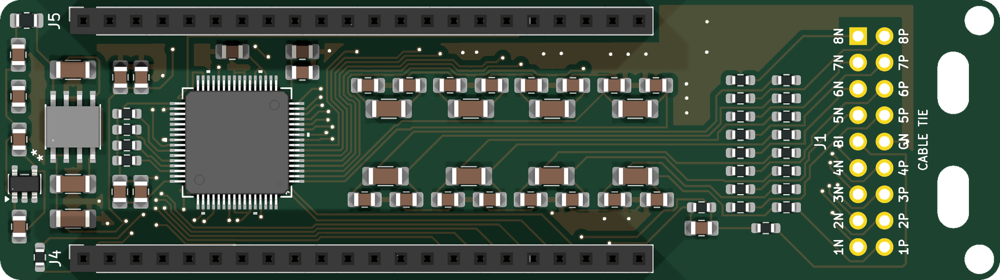

# Hardware

근전도 측정 하드웨어입니다.

| Folder | Description |
|---|---|
| [`ads1299_board`](ads1299_board) | 8채널 ADS1299 보드 KiCad 프로젝트, 회로도, 제작 파일 |
| [`ads1299_firmware`](ads1299_firmware) | ESP32-S3 펌웨어: 보드 자가 검진, 실시간 스트리밍 |
| [`emg_electrode_band`](emg_electrode_band) | 전극 블록·뚜껑 CAD, 착용 렌더링 |

## Setup

1. [`ads1299_board`](ads1299_board)의 파일로 보드를 제작하고 ESP32-S3-DevKitC-1에 연결합니다.
2. [`ads1299_firmware`](ads1299_firmware)의 펌웨어를 올리고 자가 검진을 실행합니다.
3. [`emg_electrode_band`](emg_electrode_band)의 블록을 출력해 전극선을 J1에 납땜합니다.
