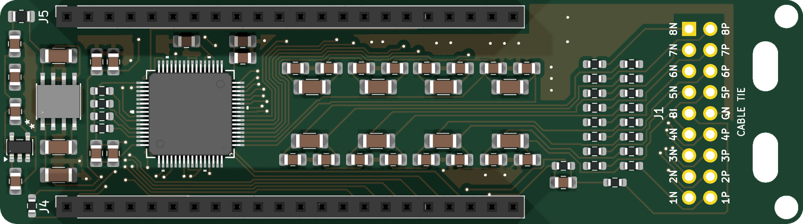
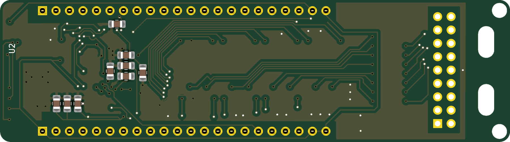
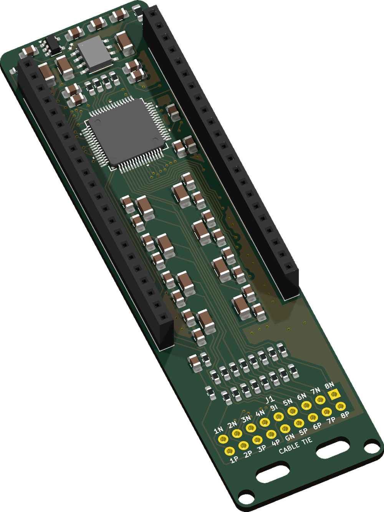
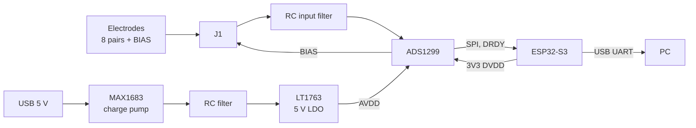

# ADS1299 EMG Board

8채널 근전도 측정 보드입니다. ESP32-S3-DevKitC-1 위에 소켓으로 얹어 사용합니다.







위 그림은 KiCad PCB 파일에서 만든 렌더링입니다.

## Specifications

| Item | Value |
|---|---|
| Board | 27 × 96 mm, 2 layers, ENIG |
| AFE | TI ADS1299IPAG (TQFP-64), 8 channels, 24-bit |
| Stream settings | 2000 SPS, gain 24 (±187.5 mV), differential + BIAS |
| Input filter (per channel) | 10 kΩ, 4.7 nF differential, 47 pF common mode |
| Analog supply | 5 V from MAX1683 charge pump + LT1763 LDO |
| Digital supply | 3.3 V from ESP32-S3 |
| Host link | ESP32-S3 UART USB, 921600 baud |

## Block diagram



Analog and digital ground are joined at a single point (NT1).

## Main parts

| Ref | Part | Function |
|---|---|---|
| U1 | ADS1299IPAG | 8-channel analog front end |
| U2 | MAX1683EUK+T | Charge pump |
| U3 | LT1763CS8-5#PBF | 5 V low-noise LDO |
| C1–C8 | 4.7 nF C0G | Differential input filter |
| C9–C24 | 47 pF C0G | Common-mode input filter |
| R18, C25 | 1 MΩ, 1.5 nF | BIAS feedback |
| R24 | 10 Ω | Charge pump RC filter |
| C31 | 100 µF | VCAP1 |
| C47, C48 | 1 µF | Additional AVDD decoupling |
| J1 | 2×9 terminal | Electrode wires |
| J4, J5 | 1×22 socket | ESP32-S3-DevKitC-1 |

Full list with part numbers: [`fabrication/BOM_handsolder.csv`](fabrication/BOM_handsolder.csv)

## J1 electrode terminal

Top view, with the silkscreen labels on the board.

| | | | | | | | | | |
|---|---|---|---|---|---|---|---|---|---|
| Upper row | 1N | 2N | 3N | 4N | BI | 5N | 6N | 7N | 8N |
| Lower row | 1P | 2P | 3P | 4P | GN | 5P | 6P | 7P | 8P |

- `nN`, `nP`: channel n inputs
- `BI`: BIAS electrode
- `GN`: analog ground for scope probes, not an electrode

Clean flux off with IPA after soldering. The ADS1299 inputs are high impedance.

## ESP32-S3 connections

| Board | Signal | ESP32-S3 |
|---|---|---|
| J4.1 | DVDD | 3V3 |
| J4.15 | DRDY | GPIO9 |
| J4.16 | CS | GPIO10 |
| J4.17 | DIN | GPIO11 |
| J4.18 | SCLK | GPIO12 |
| J4.19 | DOUT | GPIO13 |
| J4.20 | START | GPIO14 |
| J4.21 | 5V | 5V |
| J5.17 | RESET | GPIO47 |
| J5.18 | PWDN | GPIO21 |
| J4.22, J5.1, J5.21, J5.22 | GND | GND |

GPIO47 runs at 1.8 V on WROOM-2 modules (`V` suffix), which is too low for RESET. Check the module before use. See [`docs/design_review.md`](docs/design_review.md).

## Test results

Measured on an assembled board with the self-test firmware (2026-11-02).

| Test | Result |
|---|---|
| AVDD / DVDD | 5.008 V / 3.093 V |
| Input-shorted noise, 2000 SPS, gain 24 | 0.394 µVrms (worst channel) |
| Internal test signal | 3.70 mVpp, 2.00 Hz (expected 3.75 mVpp) |

KiCad 10 ERC and DRC report no errors (2026-11-04).

## Files

```
emg_ads1299.kicad_pro    KiCad project
emg_ads1299.kicad_sch    Schematic
emg_ads1299.kicad_pcb    PCB
fp-lib-table             Footprint libraries
sym-lib-table            Symbol libraries
lib/
  symbols/               Project symbols
  footprints/            Project footprints
  3d/                    3D models
fabrication/
  gerber/                Gerber and drill files
  BOM_handsolder.csv     BOM with DigiKey part numbers
  BOM_jlcpcb.csv         BOM for JLCPCB assembly
  CPL_jlcpcb.csv         Placement file for JLCPCB assembly
docs/
  schematic.pdf          Schematic
  design_review.md       Design review
  CHANGELOG.md           Board revision notes
  images/                Board renders
```

Open `emg_ads1299.kicad_pro` in KiCad 10 or later. Library paths are relative to the project folder.

To regenerate the renders:

```bash
kicad-cli pcb render --side top --quality high --width 900 --height 2400 --background transparent -o top.png emg_ads1299.kicad_pcb
kicad-cli sch export pdf -o docs/schematic.pdf emg_ads1299.kicad_sch
```
