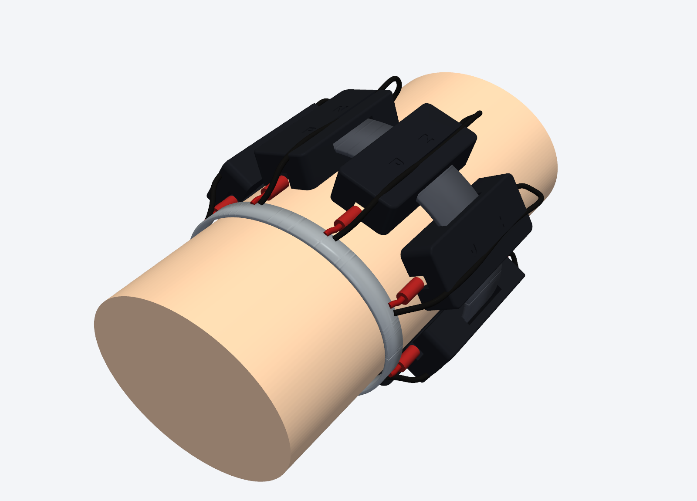
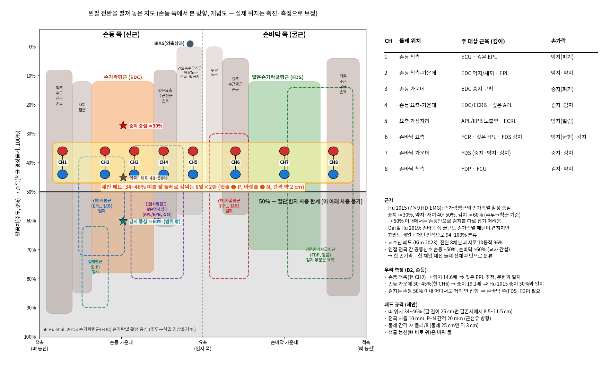

# Electrode Band

전완에 두르는 8채널 전극 밴드입니다. 전극 블록 하나가 채널 하나이고, 전극 2개가 들어갑니다.





위 그림은 CAD 렌더링과 배치 도면입니다.

## Files

```
cad/
  emg_electrode_block.py     Block and lid model (CadQuery)
  emg_electrode_block.step   Block
  emg_electrode_block.stl
  emg_electrode_lid.step     Lid
  emg_electrode_lid.stl
scripts/
  render_band.py             Band renders (PyVista)
  export_worn_assembly.py    Export worn assembly as PLY
  render_blender.py          Blender render
  draw_electrode_layout.py   Electrode layout drawing
  draw_electrode_hand.py     Placement guide drawing
images/                      Renders and drawings
```

## Generate CAD

```bash
cd cad
python emg_electrode_block.py
```

STEP와 STL 파일이 `cad/`에 저장됩니다.
